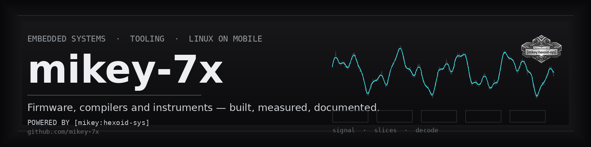
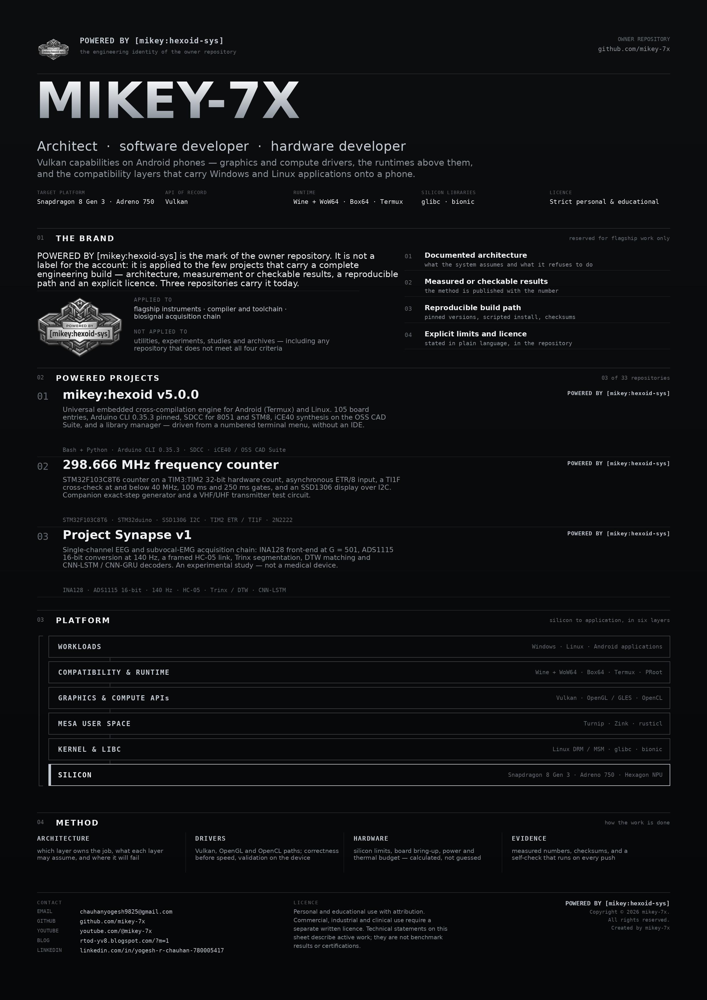
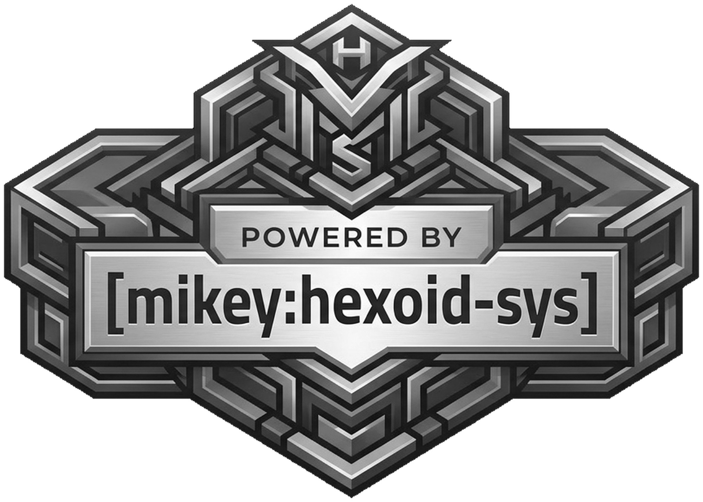
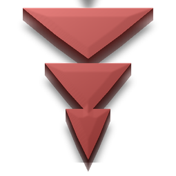
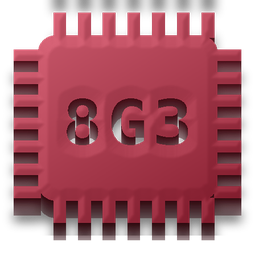
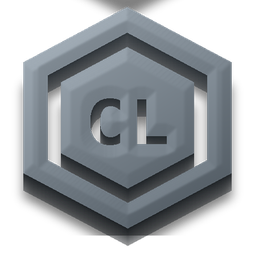
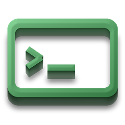

<div align="center">



<br>

<a href="https://github.com/mikey-7x?tab=repositories"></a>


<h1>mikey-7x</h1>

<p><b>Architect · software developer · hardware developer</b><br>
Vulkan capabilities on Android phones — drivers, runtimes and the compatibility layers above them.</p>

<p><code>POWERED BY [mikey:hexoid-sys]</code> — the brand of the advanced builds:<br>
long research, testing and verification — advanced tools and structures.</p>

</div>

---

## About

I work on the layer between a phone's silicon and the software people want to run on it:
**graphics and compute drivers, the runtimes that talk to them, and the compatibility layers
that carry Windows and Linux applications onto Android.**

The development target is a **Snapdragon 8 Gen 3** platform: **Adreno 750** GPU, **Hexagon**
NPU and Kryo CPU, with **Vulkan** as the API of record through **Turnip** and **Mesa**, and
**glibc** and **bionic** as the two C libraries the same kernel has to satisfy.

Everything here is **active engineering work, described as such** — not certified results, not
benchmark claims. Where a number appears, the method behind it is published with it.

<div align="center">

<a href="assets/introduction-poster.pdf"></a>

<b>Owner repository poster</b> — twenty relief marks of the tools, drivers, runtimes, silicon
and libraries the work is built on, with the brand and its scope.<br>
<a href="assets/introduction-poster.png">PNG</a> ·
<a href="assets/introduction-poster.pdf">PDF (A2, print)</a>

</div>

## The brand — `POWERED BY [mikey:hexoid-sys]`

<div align="center">



</div>

**Every repository on this account is my own work** — designed, built, tested and documented
by me. `POWERED BY [mikey:hexoid-sys]` does not mark ownership; it marks **the highly advanced
projects**: the few where a long period of research, analysis, study and learning came before
the build, and where the result has been **tested and verified** rather than merely published.

The mark therefore stands for a complete engineering build — the four conditions below — and
it is deliberately narrow. Utilities, experiments, studies and archives on this account are
**just as much my creations**; they simply do not carry the mark.

**A repository carries the mark only when all four conditions hold:**

| # | Condition | What it means |
| --- | --- | --- |
| 1 | **Documented architecture** | the system's assumptions, layers and refusals are written down |
| 2 | **Measured or checkable results** | a number is published together with the method that produced it |
| 3 | **Reproducible build path** | pinned versions, a scripted install, published checksums |
| 4 | **Explicit limits and licence** | limits, safety rules and licence in plain language |

**Applied to:** the advanced builds — a compiler and toolchain, a bench instrument, a biosignal
acquisition chain. Each of them took long research, repeated analysis and a verification pass
before the mark was applied.

**Not applied to:** utilities, one-liners, experiments, studies and archives. They are my work
as well; they are published under [Other work](#other-work--no-brand) without the mark.

## Powered projects

<table>
<tr>
<td width="50%" valign="top">

### mikey:hexoid v5.0.0

Universal embedded cross-compilation engine for Android (Termux) and Linux. 105 board
entries, Arduino CLI 0.35.3 pinned, SDCC for 8051 and STM8, iCE40 synthesis on the OSS CAD
Suite, and a library manager — driven from a numbered terminal menu, without an IDE.

`Bash` · `Python` · `Arduino CLI 0.35.3` · `SDCC` · `iCE40 / OSS CAD Suite`

**[Repository →](https://github.com/mikey-7x/mikey-hexoid-v5.0.0)**

</td>
<td width="50%" valign="top">

### 298.666 MHz frequency counter

STM32F103C8T6 counter on a TIM3:TIM2 32-bit hardware count, asynchronous ETR/8 input, a TI1F
cross-check at and below 40 MHz, 100 ms and 250 ms gates, and an SSD1306 display over I2C.
Companion exact-step generator and a VHF/UHF transmitter test circuit.

`STM32F103C8T6` · `STM32duino` · `SSD1306 I2C` · `TIM2 ETR / TI1F` · `2N2222`

**[Repository →](https://github.com/mikey-7x/298.666mhz-frequency-counter-using-stm32f103c8t6-and-vhf-uhf-fm-transmitter-circuit)**

</td>
</tr>
<tr>
<td width="50%" valign="top">

### Project Synapse v1

Single-channel EEG and subvocal-EMG acquisition chain: INA128 front-end at G = 501, ADS1115
16-bit conversion at 140 Hz, a framed HC-05 link, Trinx segmentation, DTW matching and
CNN-LSTM / CNN-GRU decoders. An experimental study — not a medical device.

`INA128` · `ADS1115 16-bit` · `140 Hz` · `HC-05` · `Trinx / DTW` · `TensorFlow`

**[Repository →](https://github.com/mikey-7x/Project-Synapse-v1-official-Real-Time-Brainwave-Decoder-with-Android)**

</td>
<td width="50%" valign="top">

### Why only three

Because these are the three repositories that meet every condition at once: a written
architecture, results that can be checked, a reproducible build, and an explicit licence.

There is no plan to extend the mark for the sake of coverage. A repository either meets the
four conditions or it does not.

</td>
</tr>
</table>

## Method

```text
1 · problem       a workload that does not run, or a bench measurement that does not exist
2 · architecture  which layer owns the job, what each layer may assume, where it will fail
3 · drivers       Vulkan / OpenGL / OpenCL paths — correctness before speed, validation on device
4 · hardware      silicon limits, board bring-up, power and thermal budget — calculated, not guessed
5 · tooling       reproducible build path, pinned versions, scripted install
6 · evidence      measured numbers, checksums, and a self-check that runs on every push
7 · honesty       limits, safety rules and licence stated in the repository
```

## Toolchain and platform

Every tool, driver, runtime, library and piece of silicon the work is built on — drawn as a
relief mark, one per component. The same twenty marks form the poster above and are stored in
[`assets/toolchain/`](assets/toolchain/) with an [index](assets/toolchain/INDEX.txt).

<div align="center">

<table>
<tr>
<td align="center" width="20%">
<br>
<b>Vulkan</b>
</td>
<td align="center" width="20%">
<br>
<b>Snapdragon 8 Gen 3</b>
</td>
<td align="center" width="20%">
<br>
<b>Adreno 750</b>
</td>
<td align="center" width="20%">
<br>
<b>Hexagon NPU</b>
</td>
<td align="center" width="20%">
<br>
<b>Mesa</b>
</td>
</tr>
<tr>
<td align="center" width="20%">
<br>
<b>Turnip</b>
</td>
<td align="center" width="20%">
<br>
<b>Zink</b>
</td>
<td align="center" width="20%">
<br>
<b>rusticl</b>
</td>
<td align="center" width="20%">
<br>
<b>OpenGL / GLES</b>
</td>
<td align="center" width="20%">
<br>
<b>OpenCL</b>
</td>
</tr>
<tr>
<td align="center" width="20%">
<br>
<b>Linux kernel</b>
</td>
<td align="center" width="20%">
<br>
<b>glibc</b>
</td>
<td align="center" width="20%">
<br>
<b>bionic</b>
</td>
<td align="center" width="20%">
<br>
<b>Android</b>
</td>
<td align="center" width="20%">
<br>
<b>Termux</b>
</td>
</tr>
<tr>
<td align="center" width="20%">
<br>
<b>Termux:X11</b>
</td>
<td align="center" width="20%">
<br>
<b>Box64</b>
</td>
<td align="center" width="20%">
<br>
<b>Wine</b>
</td>
<td align="center" width="20%">
<br>
<b>WoW64</b>
</td>
<td align="center" width="20%">
<br>
<b>Hardware acceleration</b>
</td>
</tr>
</table>

</div>

**The emblems are original stylised symbols drawn for this repository** by
`tools/emblems.py` — not vendor artwork. They identify the components; they do not imply
affiliation or endorsement by the projects named.

### Layers, in order

| Layer | Components | Where I work |
| --- | --- | --- |
| **Workloads** | Windows, Linux and Android applications | Win32 / Win64 binaries, ELF (glibc), Android (bionic, ART) |
| **Compatibility & runtime** | Wine + WoW64 · Box64 · Termux · Termux:X11 · PRoot | 32- and 64-bit Windows software, x86_64 → ARM64, a Linux user space on the phone |
| **Graphics & compute APIs** | Vulkan · OpenGL / GLES · OpenCL | explicit GPU work, legacy and mobile 3D, compute kernels |
| **Mesa user space** | Turnip · Zink · rusticl | Adreno Vulkan, OpenGL on Vulkan, OpenCL on Mesa |
| **Kernel & libc** | Linux kernel (DRM / MSM) · glibc · bionic | power, scheduling, buffer handling, two C libraries on one kernel |
| **Silicon** | Snapdragon 8 Gen 3 · Adreno 750 · Hexagon NPU | GPU and NPU offload, hardware acceleration |

### Work areas

- **Vulkan on Adreno** — Turnip feature exposure, extension support and validation; version and
  profile work against what the hardware can hold; memory model, synchronisation and cache
  behaviour before throughput.
- **Mesa user space** — Zink (OpenGL on Vulkan), rusticl (OpenCL on Mesa), Gallium state
  trackers, shader caches, and isolating a driver fault down to a single call.
- **Kernel and hardware acceleration** — DRM / MSM power, scheduling and buffer handling;
  Adreno 750 and Hexagon utilisation and offload; where acceleration is real and where it
  silently falls back.
- **Platform and compatibility** — Termux and Termux:X11 for a Linux user space and a desktop on
  the phone, Box64 for x86_64 binaries, Wine + WoW64 for 32-bit Windows software in a 64-bit
  container.

## Other work — no brand

These repositories are **my own work as well** — published on their own terms as utilities,
experiments, studies and archives. They do not carry `POWERED BY [mikey:hexoid-sys]`, because
the mark is reserved for the advanced builds described above.

| Area | Repositories |
| --- | --- |
| **Graphics, drivers & compute** | [Termux-VLSI-Studio](https://github.com/mikey-7x/Termux-VLSI-Studio) · [Watari-ARM64-Studio](https://github.com/mikey-7x/Watari-ARM64-Studio) · [OpenROAD-on-Android](https://github.com/mikey-7x/OpenROAD-on-Android) |
| **Linux on Android** | [Termux-projects](https://github.com/mikey-7x/Termux-projects) · [About-Termux](https://github.com/mikey-7x/About-Termux) · [Linux](https://github.com/mikey-7x/Linux) · [Headless-firefox](https://github.com/mikey-7x/Headless-firefox) |
| **Compilers & tooling** | [latex-to-pdf](https://github.com/mikey-7x/latex-to-pdf) · [aider-termux-installer](https://github.com/mikey-7x/aider-termux-installer) · [Arch-Claude-CLI](https://github.com/mikey-7x/Arch-Claude-CLI) |
| **Instruments & measurement** | [FL meter](https://github.com/mikey-7x/FL-meter) · [4-bit synchronous BCD counter](https://github.com/mikey-7x/4-Bit-Synchronous-BCD-Counter) · [WL indicator](https://github.com/mikey-7x/WL-indicator) |
| **Biosignals** | [Project Synapse (original)](https://github.com/mikey-7x/Project-Synapse-Real-Time-Brainwave-Decoder-with-Android) |
| **Automotive & safety** | [DSS4 driver safety system](https://github.com/mikey-7x/DSS4-Driver-Safety-System) · [DSS driver safety system](https://github.com/mikey-7x/DSS-driver-safety-system) · [Homepulse](https://github.com/mikey-7x/Homepulse-Microbaot) |
| **Power & analog** | [TMCD tripolar MOSFET class-D amplifier](https://github.com/mikey-7x/TMCD-Amplifier-Tripolar-MOSFET-Class-D-Amplifier) · [Solar street-light driver teardown](https://github.com/mikey-7x/Solar-Street-Light-DC-LED-Driver) · [LTspice Library AutoSync](https://github.com/mikey-7x/LTspice-Library-AutoSync-HID-Blue-Pill-Implementation-) |
| **Industrial tooling** | [MicroWIN V4 / Win11 bypass](https://github.com/mikey-7x/MicroWIN-V4-Win11-Bypass) |
| **Security research** | [pf15](https://github.com/mikey-7x/pf15-penetration-fast-15) · [ngrok in Termux](https://github.com/mikey-7x/ngrok-how-to-use-ngrok-in-termux) |
| **Learning & archives** | [Applied Electronics Archive](https://github.com/mikey-7x/Applied-Electronics-Archive) · [Tensorflow in Android](https://github.com/mikey-7x/Tensorflow-in-Android) · [RTOD-yv8](https://github.com/mikey-7x/RTOD-yv8) |

**[View all 33 repositories →](https://github.com/mikey-7x?tab=repositories)**

## Working with this account

- **Issues first.** A bug report with the platform, the version and the first error line gets
  answered fastest.
- **Reproducibility matters.** Pin versions, publish commands, include checksums.
- **No medical, certified or guaranteed claims.** Where a project is experimental, it says so
  on the front page and in the licence.

## Contact

| | |
| --- | --- |
| **Email** | [chauhanyogesh9825@gmail.com](mailto:chauhanyogesh9825@gmail.com) |
| **GitHub** | [github.com/mikey-7x](https://github.com/mikey-7x) |
| **YouTube** | [youtube.com/@mikey-7x](https://youtube.com/@mikey-7x) |
| **Blog** | [rtod-yv8.blogspot.com](https://rtod-yv8.blogspot.com/?m=1) |
| **LinkedIn** | [linkedin.com/in/yogesh-r-chauhan-780005417](https://www.linkedin.com/in/yogesh-r-chauhan-780005417) |

## Licence and credit

Projects on this account are published under the **mikey-7x Strict Personal & Educational Use
Licence**: free for personal, hobbyist and educational use with attribution. Commercial,
industrial and clinical use require a separate signed written licence. Each repository carries
its own `LICENSE` file — read it before building.

If you reuse or adapt anything, keep this credit with the work:

```text
Created by mikey-7x
POWERED BY [mikey:hexoid-sys]        (owner repository and the three powered projects only)
Copyright © 2026 mikey-7x. All rights reserved.
GitHub:  https://github.com/mikey-7x
Email:   chauhanyogesh9825@gmail.com
```

<div align="center">


**`POWERED BY [mikey:hexoid-sys]`**

Copyright © 2026 mikey-7x. All rights reserved.

[Repositories](https://github.com/mikey-7x?tab=repositories) ·
[YouTube](https://youtube.com/@mikey-7x) ·
[Blog](https://rtod-yv8.blogspot.com/?m=1) ·
[LinkedIn](https://www.linkedin.com/in/yogesh-r-chauhan-780005417) ·
[Email](mailto:chauhanyogesh9825@gmail.com)

<sub>Published under a non-commercial, source-available licence. No affiliation with or
endorsement by any vendor named above. All technical statements describe areas of active
work; they are not benchmark results or certifications.</sub>

</div>
